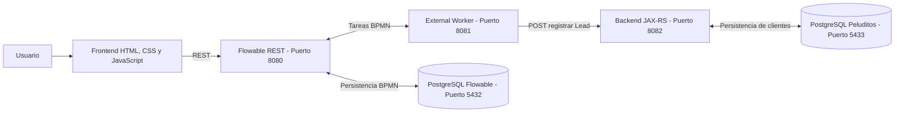

# Arquitectura - Evaluacion 3

## Peluditos Pet Chile

## Componentes

- Frontend: registro de Leads y gestion de tareas.
- Flowable REST: ejecucion de procesos BPMN.
- External Worker: comunicacion entre Flowable y Backend.
- Backend JAX-RS: registro y consulta de clientes.
- PostgreSQL Flowable: persistencia de procesos.
- PostgreSQL Peluditos: persistencia de datos del negocio.

## Limitaciones conocidas

El proceso de Leads fue probado de extremo a extremo.

El proceso de Oportunidades contiene tareas automaticas
simuladas. La integracion real de notificaciones queda
pendiente para la Entrega 4.

Las credenciales se configuran mediante variables
de entorno y no deben publicarse.
